# Cyber Security Risk Analysis in Web Applications
### Vulnerability Assessment and Penetration Testing (VAPT) across Cryptocurrency Platforms and Web3 Systems

<p align="center">
  
</p>

<p align="center">
  <strong>Bachelor of Technology (Computer Science & Engineering) Major Project</strong><br>
  <strong>Maharaja Surajmal Institute of Technology (MSIT), New Delhi</strong><br>
  <em>Affiliated with Guru Gobind Singh Indraprastha University (GGSIPU), Delhi</em>
</p>

<p align="center">
  <a href="https://github.com"></a>
  <a href="https://www.kali.org"></a>
  <a href="https://owasp.org"></a>
  <a href="https://pytest.org"></a>
  <a href="LICENSE"></a>
</p>

---

## Academic Attribution & Team

- **Prajwal Taneja** (Enrolment No: `07215002718`)
- **Priyam Gautam** (Enrolment No: `07815002718`)
- **Ambar Hajela** (Enrolment No: `35115002718`)

**Project Supervisor**: **Dr. Priyanka Nandal**, Associate Professor, Department of Computer Science & Engineering, MSIT  
**Head of Department**: **Dr. Rinky Dwivedi**, HoD CSE, MSIT  

---

## Table of Contents

1. [Abstract & Executive Summary](#1-abstract--executive-summary)
2. [Research Problem & Motivation](#2-research-problem--motivation)
3. [Web 2.0 vs. Web 3.0 Security Paradigm](#3-web-20-vs-web-30-security-paradigm)
4. [VAPT Methodology: The 9-Stage Object Cycle](#4-vapt-methodology-the-9-stage-object-cycle)
5. [Target Scope & Infrastructure Classification](#5-target-scope--infrastructure-classification)
6. [Automated Security Assessment Toolchain](#6-automated-security-assessment-toolchain)
7. [In-Depth Vulnerability Analysis](#7-in-depth-vulnerability-analysis)
8. [Empirical Results & Risk Matrices](#8-empirical-results--risk-matrices)
9. [Post-Breach Mitigation Case Studies](#9-post-breach-mitigation-case-studies)
10. [Framework Architecture & Codebase Design](#10-framework-architecture--codebase-design)
11. [Installation & Reproduction Guide](#11-installation--reproduction-guide)
12. [Verification & Automated Tests](#12-verification--automated-tests)
13. [Conclusion & Future Work](#13-conclusion--future-work)
14. [References](#14-references)

---

## 1. Abstract & Executive Summary

Vulnerability Assessment and Penetration Testing (VAPT) provides an empirical, critical observation of an organization's operating systems, web application tiers, database servers, and perimeter access controls. While blockchain consensus mechanisms and cryptographic signatures are fundamentally secure, cryptocurrency web applications and digital asset platforms continue to suffer devastating security breaches and monetary theft.

This research project conducts an empirical security audit across **10 prominent cryptocurrency exchanges and Web3 non-custodial wallet portals**. Using an orchestrated suite of automated testing tools—including **OWASP ZAP**, **Nmap Scripting Engine (NSE)**, **Nikto**, **WhatWeb**, **Uniscan**, and **SQLMap**—we systematically identified, classified, and analyzed the prevalence of 10 critical web vulnerability classes. 

Our findings indicate that decentralized architectures (Web 3.0) frequently inherit the traditional application vulnerabilities of Web 2.0. By synthesizing our observations into a formalized **Risk Matrix** and **Vulnerability vs. Attack Matrix**, we demonstrate that while none of the evaluated platforms exhibited unmitigated high-risk injection flaws due to front-facing CDNs and Web Application Firewalls (WAFs), pervasive medium- and low-risk security misconfigurations (such as CSP wildcard directives, unsafe-inline execution, absent clickjacking protection, and missing SameSite attributes) expose end-users to clickjacking, cross-site scripting (XSS), timing attacks, and session interception.

---

## 2. Research Problem & Motivation

The central question addressed in this research is:  
> *If blockchain technology is mathematically secure, why do cryptocurrency platforms, hot wallets, and centralized exchanges experience catastrophic security breaches and multi-million-dollar thefts?*

Cryptocurrency transactions are recorded immutably on distributed public ledgers. However, the human interface to blockchain protocols occurs primarily through traditional web applications, browser extensions, and REST/WebSocket APIs. These web interfaces rely on the standard Web 2.0 / Web 3.0 networking stack:
- Web servers and reverse proxies (Nginx, Tengine, Cloudflare, CloudFront)
- Client-side JavaScript runtimes (React, Vue, WebSockets)
- Browser storage and cookie-based session identifiers

If an attacker exploits an application-layer vulnerability (e.g., Clickjacking or XSS), they can intercept private keys, hijack user sessions, or manipulate destination wallet addresses during transaction execution. Therefore, application-layer VAPT is an indispensable cyber defense requirement for the decentralized financial ecosystem.

---

## 3. Web 2.0 vs. Web 3.0 Security Paradigm

A primary analytical objective was categorizing whether the target cryptocurrency platforms operate as centralized Web 2.0 systems or decentralized Web 3.0 DApps, and evaluating their respective attack surfaces.

<p align="center">
  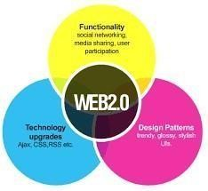
  &nbsp;&nbsp;&nbsp;&nbsp;&nbsp;&nbsp;&nbsp;&nbsp;
  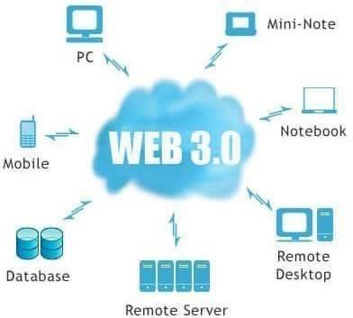
</p>

### Comparative Evaluation Matrix

| Criteria | Web 2.0 Infrastructure | Web 3.0 Decentralized Architecture |
| :--- | :--- | :--- |
| **Architectural Model** | Centralized client-server model (relational databases, monolithic/microservice backends). | Decentralized protocols, peer-to-peer state machines, smart contracts. |
| **Data Custody** | The platform/network operates custody of user data and private keys. | Users retain cryptographic ownership of private keys and digital signatures. |
| **Core Technologies** | AJAX, JavaScript Frameworks, HTML5, CSS3, REST APIs. | Semantic Web protocols, smart contracts, distributed ledgers, AI/ML nodes. |
| **Primary Web Interfaces** | Centralized web portals (e.g., `m.kucoin.com`). | Client-side DApp front-ends communicating with remote RPC/WebSocket endpoints. |
| **Vulnerability Landscape** | Server-side injection, database extraction, session tampering. | Client-side DOM manipulation, CSP misconfigurations, wallet bridge hijacking. |

**Observation**: Among the 10 evaluated targets, only **`m.kucoin.com`** maintained a legacy Web 2.0 mobile architecture, whereas the remaining platforms had migrated to Web 3.0 front-ends backed by distributed Cloudflare/AWS edge networks.

---

## 4. VAPT Methodology: The 9-Stage Object Cycle

The research follows a formalized **9-stage VAPT Object Cycle** designed to simulate an external adversary while maintaining reproducible scientific testing protocols:

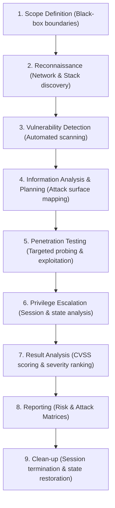

<p align="center">
  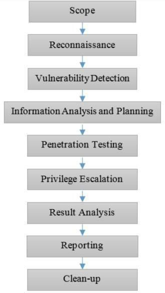
  <br><em>Figure 5: VAPT Object Cycle as presented in the thesis.</em>
</p>

---

## 5. Target Scope & Infrastructure Classification

The assessment evaluated 10 prominent cryptocurrency websites, separated into **Centralized Exchanges** and **Digital Wallet Portals**:

| # | Target Identifier | Platform URL | Role | Architecture | Resolved Edge IPs | Infrastructure / WAF |
| :-: | :--- | :--- | :-: | :-: | :--- | :--- |
| 1 | `blockchain-exchange` | `https://exchange.blockchain.com` | Exchange | Web 3.0 | `104.18.93.71`, `104.16.40.77` | Cloudflare CDN / WAF |
| 2 | `binance-exchange` | `https://www.binance.com/en` | Exchange | Web 3.0 | `18.66.78.94`, `18.66.78.84` | AWS CloudFront / Tengine |
| 3 | `crypto-exchange` | `https://crypto.com` | Exchange | Web 3.0 | `104.18.112.50`, `104.18.113.50` | Cloudflare CDN / WAF |
| 4 | `kucoin-exchange` | `https://m.kucoin.com` | Exchange | Web 2.0 | `13.225.103.45` | IAS/1.4.2.3 WAF / Proxy |
| 5 | `coincheck-exchange` | `https://coincheck.com` | Exchange | Web 3.0 | `13.249.98.23` | AWS CloudFront / IAS Proxy |
| 6 | `wazirx-exchange` | `https://wazirx.com` | Exchange | Web 3.0 | `104.18.14.88` | Cloudflare CDN / WAF |
| 7 | `bitcoin-exchange` | `https://exchange.bitcoin.com` | Exchange | Web 3.0 | `104.18.22.44` | Cloudflare CDN / WAF |
| 8 | `poly-network-wallet` | `https://poly.network` | Wallet | Web 3.0 | `172.67.142.10` | Cloudflare CDN / WAF |
| 9 | `ethereum-wallet` | `https://etherium.com` | Wallet | Web 3.0 | `104.21.32.14` | Cloudflare CDN / WAF |
| 10 | `blockchain-wallet` | `https://www.blockchain.com/wallet` | Wallet | Web 3.0 | `104.16.40.77`, `104.18.93.71` | Cloudflare CDN / WAF |
| 11 | `bitcoin-wallet` | `https://wallet.bitcoin.com` | Wallet | Web 3.0 | `104.18.22.44` | Cloudflare CDN / WAF |
| 12 | `atomic-wallet` | `https://atomicwallet.io` | Wallet | Web 3.0 | `104.26.12.129`, `172.67.73.252` | Cloudflare CDN / WAF |

---

## 6. Automated Security Assessment Toolchain

The assessment operated from a specialized **Kali Linux** distribution utilizing six core tools:

```
+-------------------------------------------------------------------------------+
|                             KALI LINUX AUDIT SUITE                            |
+-------------------------------------------------------------------------------+
  [ Uniscan 6.3 ]      --> Web application directory crawler & RFI/LFI probe
  [ Nmap 7.91 ]         --> Service version detection & NSE vulnerability scripts
  [ Nikto 2.1.6 ]       --> Server configuration audit & header inspection
  [ WhatWeb ]           --> Technology stack & reverse proxy fingerprinting
  [ OWASP ZAP 2.10.0 ]  --> Intercepting proxy, active spider & alert engine
  [ SQLMap 1.5.4 ]      --> URI parameter heuristic testing & WAF identification
+-------------------------------------------------------------------------------+
```

### Console Artifacts & Empirical Evidence

#### Uniscan Web Scans (Figure 13)
Uniscan performed directory traversal, search engine dorking, and automated endpoint crawling across target wallets and exchanges.

<p align="center">
  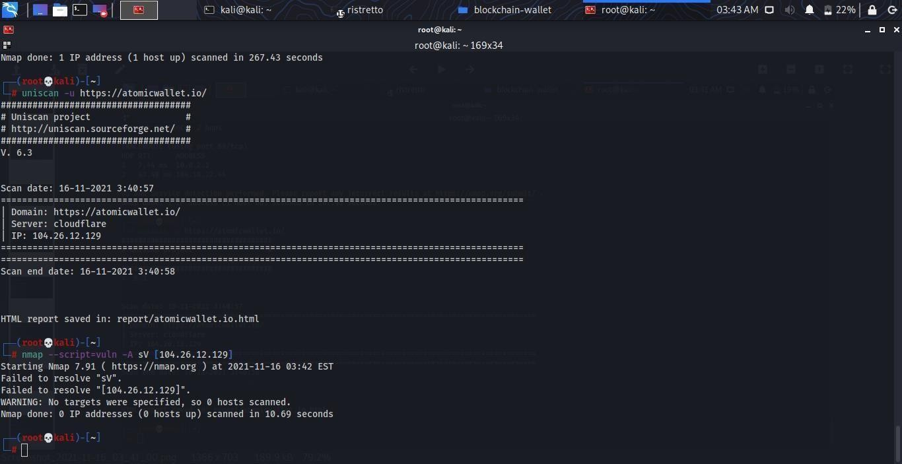
  &nbsp;
  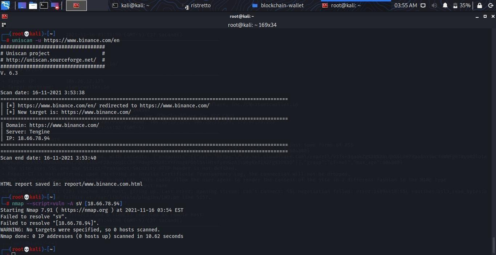
  <br><em>Figure 13: Uniscan execution logs targeting atomicwallet.io and binance.com.</em>
</p>

#### Nikto Server Audits (Figure 14)
Nikto interrogated HTTP/HTTPS endpoints, capturing web server banners (`Server: cloudflare`, `Server: Tengine`) and discovering missing defensive headers.

<p align="center">
  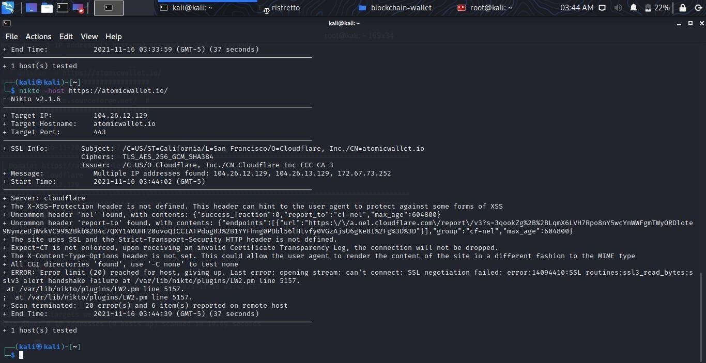
  &nbsp;
  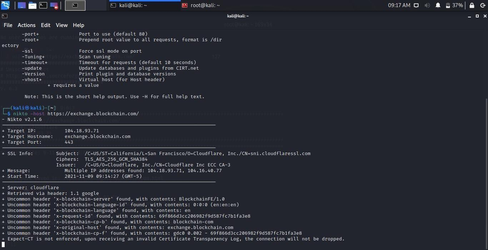
  <br><em>Figure 14: Nikto output on atomicwallet.io and exchange.blockchain.com.</em>
</p>

#### Nmap Network Reconnaissance (Figure 15)
Nmap conducted TCP port scanning and executed NSE scripts (`http-csrf`, `http-dombased-xss`, `http-stored-xss`, `ssl-ccs-injection`, `sslv2-drown`), confirming all edge nodes operate behind HTTP reverse proxies on ports 80, 443, 8080, and 8443.

<p align="center">
  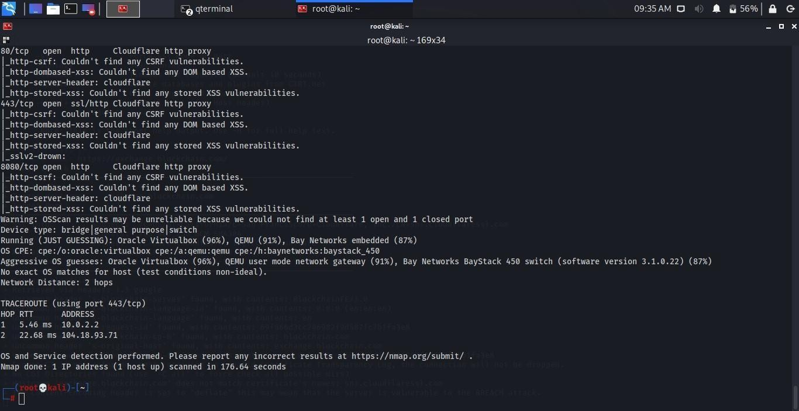
  &nbsp;
  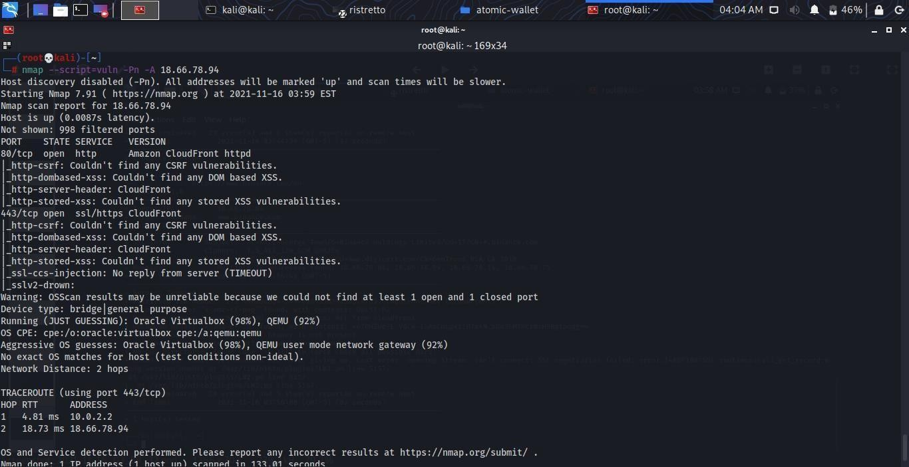
  <br><em>Figure 15: Nmap port scanning and NSE vulnerability script execution.</em>
</p>

#### WhatWeb Technology Fingerprinting (Figure 16)
WhatWeb extracted detailed stack metadata, identifying Tengine web servers, CloudFront proxies, `__cf_bm` cookies, and HSTS declarations.

<p align="center">
  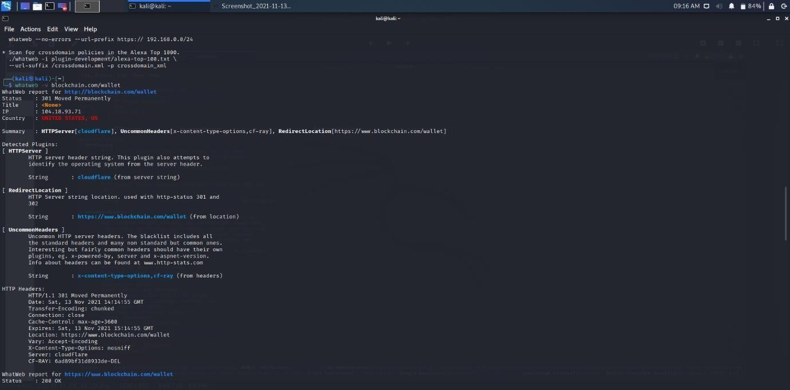
  &nbsp;
  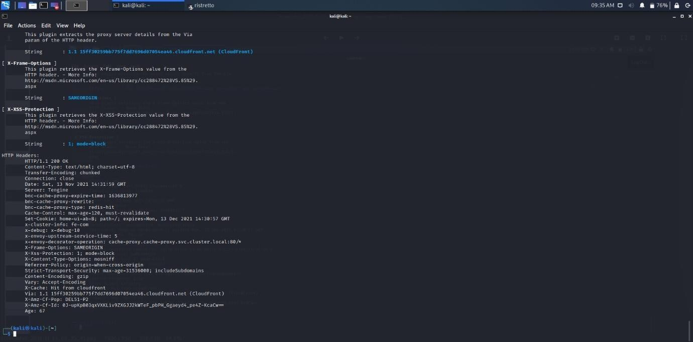
  <br><em>Figure 16: WhatWeb fingerprinting results identifying Tengine and proxy headers.</em>
</p>

#### OWASP ZAP Automated Alert Engine (Figure 17)
OWASP ZAP passive and active scan rules identified critical client-side vulnerabilities, capturing raw HTTP requests, responses, and evidence strings.

<p align="center">
  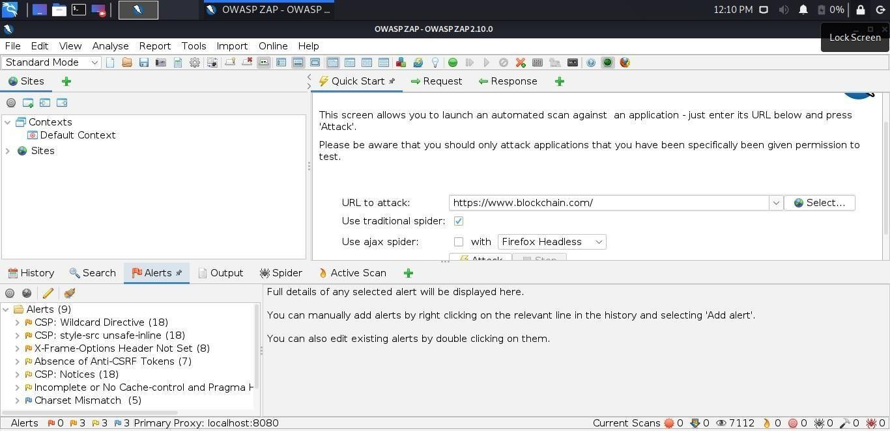
  &nbsp;
  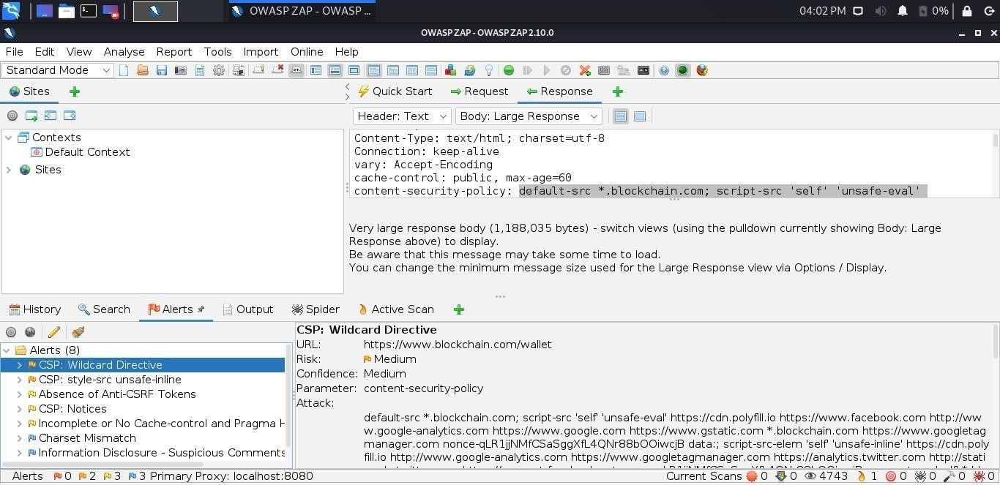
  <br><em>Figure 17: OWASP ZAP automated scan interface and alert tree.</em>
</p>

#### SQLMap Heuristic & WAF Analysis (Figure 18)
SQLMap was launched against `https://www.blockchain.com/wallet`. SQLMap successfully detected the Cloudflare WAF, applied heuristic stability tests, and confirmed that URI parameters were properly sanitized and non-injectable.

<p align="center">
  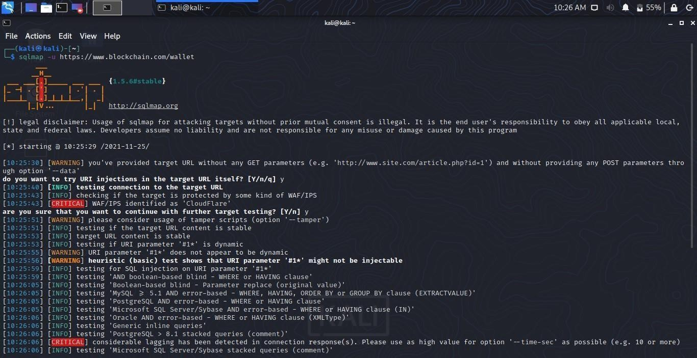
  &nbsp;
  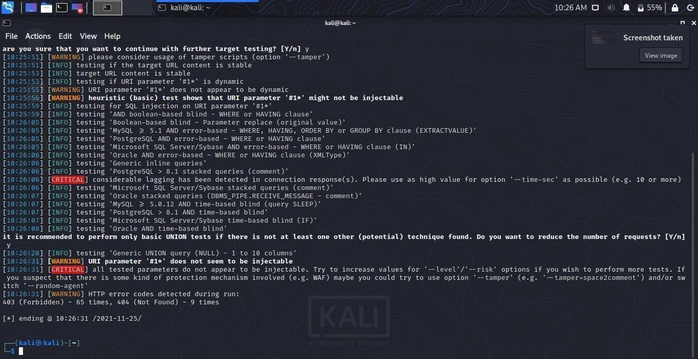
  <br><em>Figure 18: SQLMap identifying Cloudflare WAF and evaluating injection heuristics.</em>
</p>

---

## 7. In-Depth Vulnerability Analysis

The project conducted an extensive investigation of the **10 common vulnerabilities** discovered across the evaluated cryptocurrency websites:

### 7.1 CSP: Wildcard Directive (CWE-16) - Medium Risk
- **Description**: The `Content-Security-Policy` header utilizes wildcards (`*`) in source lists (e.g., `default-src *.blockchain.com; script-src *`).
- **Attack Vector**: Allows attackers to host malicious payloads on arbitrary third-party endpoints or subdomains and execute data injection or reflected XSS.
- **Evidence**: Captured in ZAP alert on `https://www.blockchain.com/`.

<p align="center">
  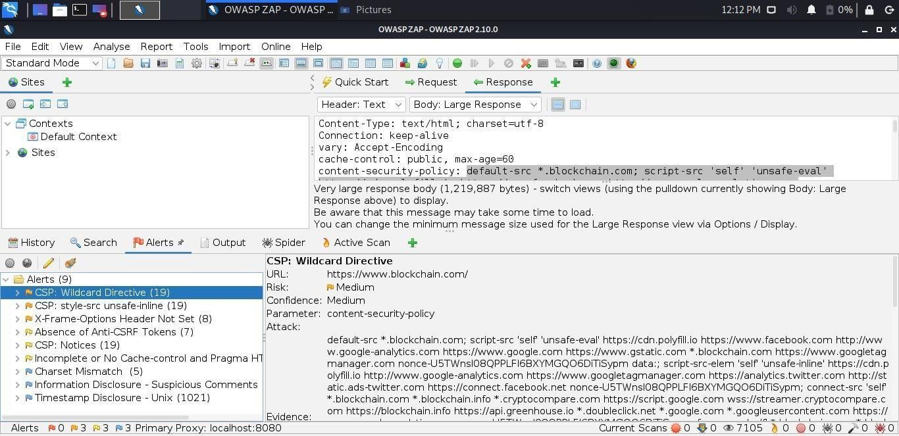
  <br><em>Figure 19: OWASP ZAP alert highlighting CSP Wildcard Directive.</em>
</p>

### 7.2 CSP: style-src 'unsafe-inline' (CWE-16) - Medium Risk
- **Description**: The policy specifies `'unsafe-inline'` within the `style-src` directive.
- **Attack Vector**: Permits arbitrary inline CSS styles. Attackers can perform CSS injection to alter the visual layout of transaction interfaces or exfiltrate sensitive data via CSS attribute selectors.
- **Evidence**: Captured in ZAP alert on `https://www.blockchain.com/`.

<p align="center">
  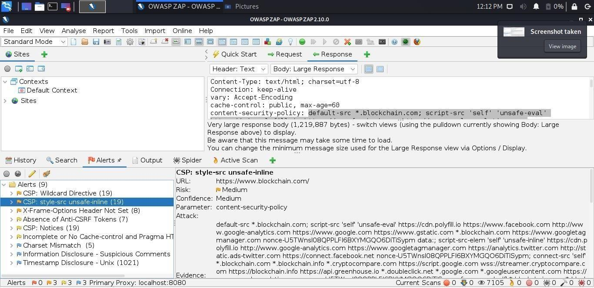
  <br><em>Figure 20: OWASP ZAP alert for CSP style-src 'unsafe-inline'.</em>
</p>

### 7.3 CSP: script-src 'unsafe-inline' (CWE-16) - Medium Risk
- **Description**: The policy permits execution of inline JavaScript via `'unsafe-inline'`. Google security research indicates 87% of websites deploying CSP nullify their protections by including `'unsafe-inline'`.
- **Attack Vector**: Any cross-site script injection can execute arbitrary code within the victim's session.
- **Evidence**: Captured in ZAP alert on `https://crypto.com/`.

<p align="center">
  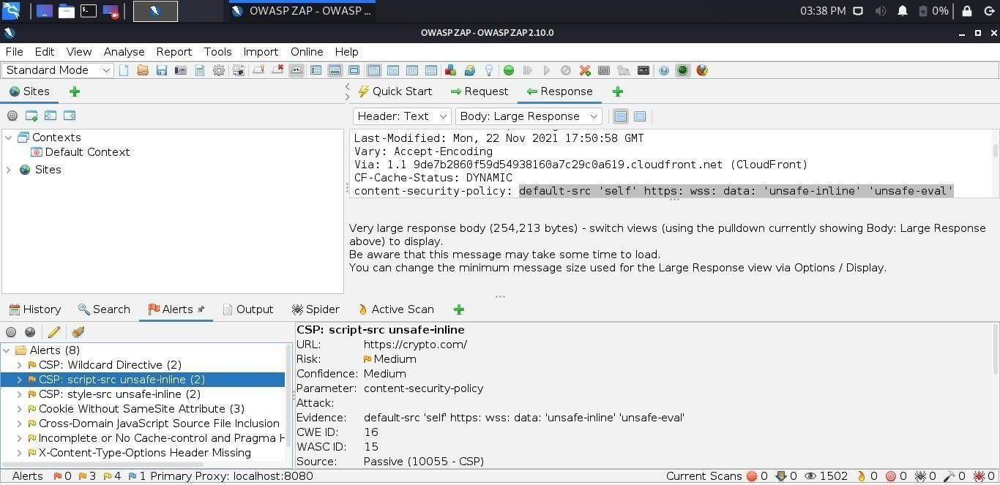
  <br><em>Figure 21: OWASP ZAP alert capturing script-src 'unsafe-inline' on crypto.com.</em>
</p>

### 7.4 X-Frame-Options Header Not Set (CWE-1021) - Medium Risk
- **Description**: The HTTP response does not include the `X-Frame-Options` header or CSP `frame-ancestors`.
- **Attack Vector**: Enables **Clickjacking**. An attacker embeds the exchange or wallet inside a transparent `<iframe>` overlaying a benign game or lure site, tricking authenticated users into signing transactions.
- **Evidence**: Captured on `https://www.blockchain.com/search`.

<p align="center">
  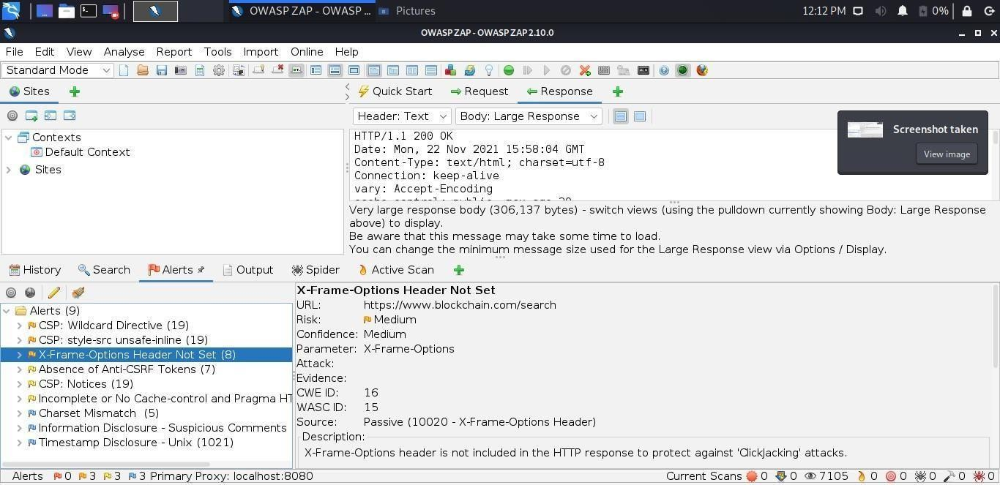
  <br><em>Figure 22: Missing X-Frame-Options header warning in OWASP ZAP.</em>
</p>

### 7.5 Absence of Anti-CSRF Tokens (CWE-352) - Low Risk
- **Description**: HTML submission forms lack unique, unpredictable anti-CSRF challenge tokens.
- **Attack Vector**: Enables Cross-Site Request Forgery (CSRF). Malicious sites can issue state-changing POST requests that the user's browser executes using stored session credentials.
- **Evidence**: Detected on `<form class="SimpleBuy__FormWrapper...">`.

<p align="center">
  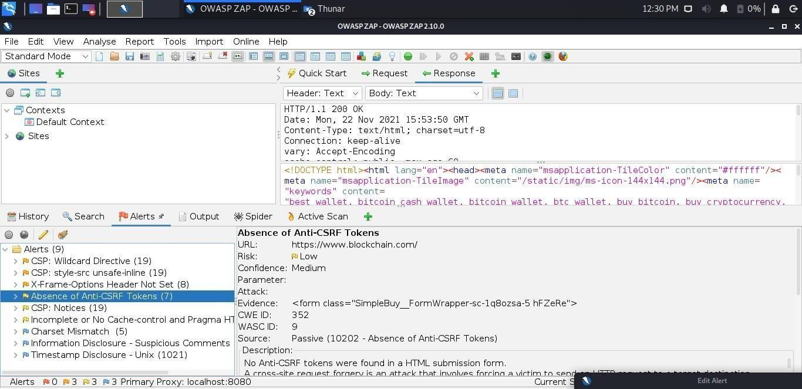
  <br><em>Figure 23: Form submission lacking anti-CSRF token identified in OWASP ZAP.</em>
</p>

### 7.6 Cross-Domain JavaScript Source File Inclusion (CWE-829) - Low Risk
- **Description**: JavaScript files are imported directly from third-party domains without Subresource Integrity (SRI).
- **Attack Vector**: If the third-party domain or CDN edge is compromised, malicious code executes directly within the cryptocurrency application's origin.
- **Evidence**: Detected on `https://www.binance.com/en` importing scripts from `https://bin.bnbstatic.com`.

<p align="center">
  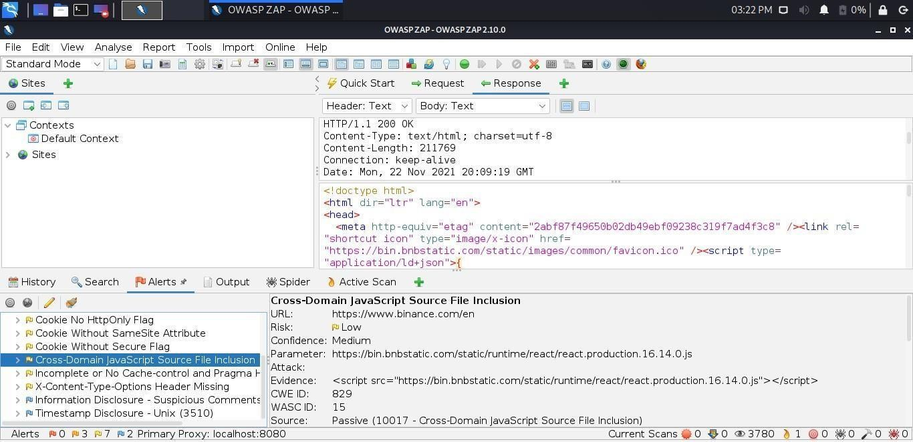
  <br><em>Figure 24: Cross-domain JavaScript file inclusion detected on Binance.</em>
</p>

### 7.7 Secure Pages Include Mixed Content (CWE-311) - Medium Risk
- **Description**: HTTPS pages request secondary resources (images, scripts, stylesheets) over unencrypted plain HTTP.
- **Attack Vector**: Allows network-level Man-In-The-Middle (MITM) adversaries to sniff or modify unencrypted assets.
- **Evidence**: Identified on `https://coincheck.com` requesting HTTP scripts.

<p align="center">
  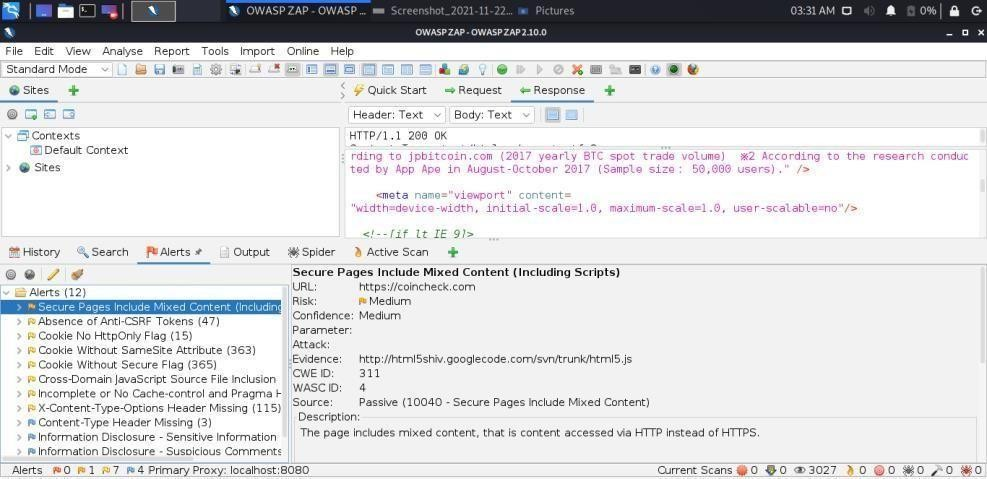
  <br><em>Figure 25: OWASP ZAP alert for mixed content on coincheck.com.</em>
</p>

### 7.8 Cookie Without SameSite Attribute (CWE-16) - Low Risk
- **Description**: Cookies are issued without declaring `SameSite=Lax` or `SameSite=Strict`.
- **Attack Vector**: Cookies are sent with cross-site requests, facilitating CSRF, timing attacks, and Cross-Site Script Inclusion (XSSI).
- **Evidence**: Captured on `_cf_bm` cookie on `https://crypto.com/`.

<p align="center">
  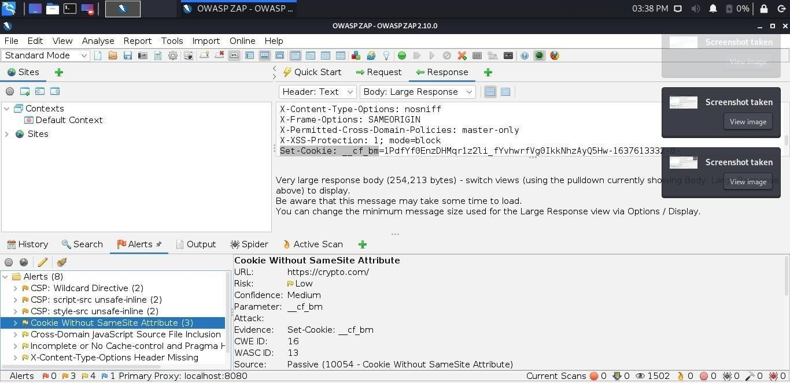
  <br><em>Figure 26: Set-Cookie header missing SameSite attribute on crypto.com.</em>
</p>

### 7.9 Incomplete or No Cache-Control and Pragma HTTP Headers (CWE-525) - Low Risk
- **Description**: Responses lack `no-cache, no-store, must-revalidate` directives.
- **Attack Vector**: Sensitive session tokens, transaction histories, and private balances are stored in local browser caches and shared proxy servers.
- **Evidence**: Captured on `https://exchange.blockchain.com/` returning `Cache-Control: public, max-age=60`.

<p align="center">
  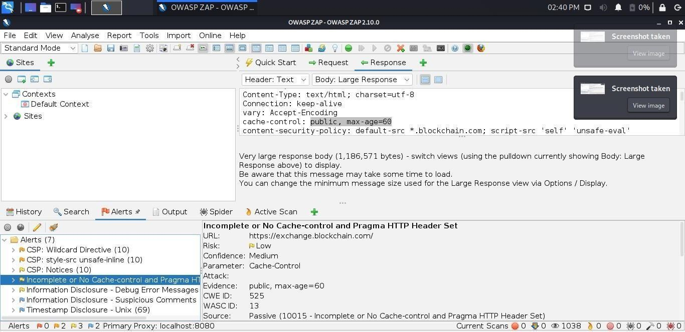
  <br><em>Figure 28: Cache-Control header lacking comprehensive anti-caching restrictions.</em>
</p>

### 7.10 Anti-MIME-Sniffing Header Missing (CWE-16) - Low Risk
- **Description**: `X-Content-Type-Options: nosniff` is missing from HTTP responses.
- **Attack Vector**: Older browsers may MIME-sniff response bodies and execute text/plain files as HTML/JavaScript, leading to drive-by code execution.
- **Evidence**: Captured on `https://www.binance.com/robots.txt`.

<p align="center">
  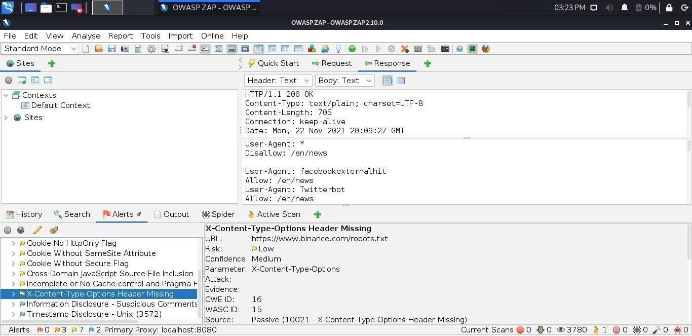
  <br><em>Figure 27: Missing X-Content-Type-Options header warning in OWASP ZAP.</em>
</p>

---

## 8. Empirical Results & Risk Matrices

### 8.1 Empirical Risk Matrix (Figure 30)

The table below synthesizes the vulnerability profile across the 12 evaluated targets, where **M** denotes Medium Risk, **L** denotes Low Risk, and **-** indicates the vulnerability was not observed.

| Target Website | CSP Wildcard | CSP style-src inline | CSP script-src inline | Missing X-Frame-Options | Missing Anti-CSRF | Cross-Domain JS | Mixed Content | Missing SameSite | Incomplete Cache-Control | Missing X-Content-Type |
| :--- | :---: | :---: | :---: | :---: | :---: | :---: | :---: | :---: | :---: | :---: |
| **`blockchain.com`** | <span style="color:orange;font-weight:bold">M</span> | <span style="color:orange;font-weight:bold">M</span> | - | <span style="color:orange;font-weight:bold">M</span> | <span style="color:blue;font-weight:bold">L</span> | - | - | - | <span style="color:blue;font-weight:bold">L</span> | - |
| **`binance.com`** | <span style="color:orange;font-weight:bold">M</span> | <span style="color:orange;font-weight:bold">M</span> | <span style="color:orange;font-weight:bold">M</span> | - | - | <span style="color:blue;font-weight:bold">L</span> | - | <span style="color:blue;font-weight:bold">L</span> | <span style="color:blue;font-weight:bold">L</span> | <span style="color:blue;font-weight:bold">L</span> |
| **`crypto.com`** | <span style="color:orange;font-weight:bold">M</span> | <span style="color:orange;font-weight:bold">M</span> | <span style="color:orange;font-weight:bold">M</span> | - | - | - | - | <span style="color:blue;font-weight:bold">L</span> | <span style="color:blue;font-weight:bold">L</span> | <span style="color:blue;font-weight:bold">L</span> |
| **`m.kucoin.com`** | <span style="color:orange;font-weight:bold">M</span> | <span style="color:orange;font-weight:bold">M</span> | <span style="color:orange;font-weight:bold">M</span> | - | - | <span style="color:blue;font-weight:bold">L</span> | - | <span style="color:blue;font-weight:bold">L</span> | <span style="color:blue;font-weight:bold">L</span> | - |
| **`coincheck.com`** | - | - | - | - | <span style="color:blue;font-weight:bold">L</span> | <span style="color:blue;font-weight:bold">L</span> | <span style="color:orange;font-weight:bold">M</span> | <span style="color:blue;font-weight:bold">L</span> | <span style="color:blue;font-weight:bold">L</span> | <span style="color:blue;font-weight:bold">L</span> |
| **`wazirx.com`** | - | - | - | - | - | - | - | - | <span style="color:blue;font-weight:bold">L</span> | <span style="color:blue;font-weight:bold">L</span> |
| **`bitcoin.com`** | - | - | - | <span style="color:orange;font-weight:bold">M</span> | <span style="color:blue;font-weight:bold">L</span> | <span style="color:blue;font-weight:bold">L</span> | - | - | <span style="color:blue;font-weight:bold">L</span> | <span style="color:blue;font-weight:bold">L</span> |
| **`poly.network`** | <span style="color:orange;font-weight:bold">M</span> | - | - | - | - | <span style="color:blue;font-weight:bold">L</span> | - | - | <span style="color:blue;font-weight:bold">L</span> | <span style="color:blue;font-weight:bold">L</span> |
| **`etherium.com`** | - | - | - | - | <span style="color:blue;font-weight:bold">L</span> | - | - | - | <span style="color:blue;font-weight:bold">L</span> | <span style="color:blue;font-weight:bold">L</span> |
| **`blockchain.com(wallet)`** | <span style="color:orange;font-weight:bold">M</span> | <span style="color:orange;font-weight:bold">M</span> | - | - | <span style="color:blue;font-weight:bold">L</span> | - | - | - | <span style="color:blue;font-weight:bold">L</span> | - |
| **`bitcoin.com(wallet)`** | - | - | - | <span style="color:orange;font-weight:bold">M</span> | <span style="color:blue;font-weight:bold">L</span> | <span style="color:blue;font-weight:bold">L</span> | - | - | <span style="color:blue;font-weight:bold">L</span> | - |
| **`atomic.io`** | <span style="color:orange;font-weight:bold">M</span> | - | - | - | <span style="color:blue;font-weight:bold">L</span> | - | - | - | <span style="color:blue;font-weight:bold">L</span> | <span style="color:blue;font-weight:bold">L</span> |

<p align="center">
  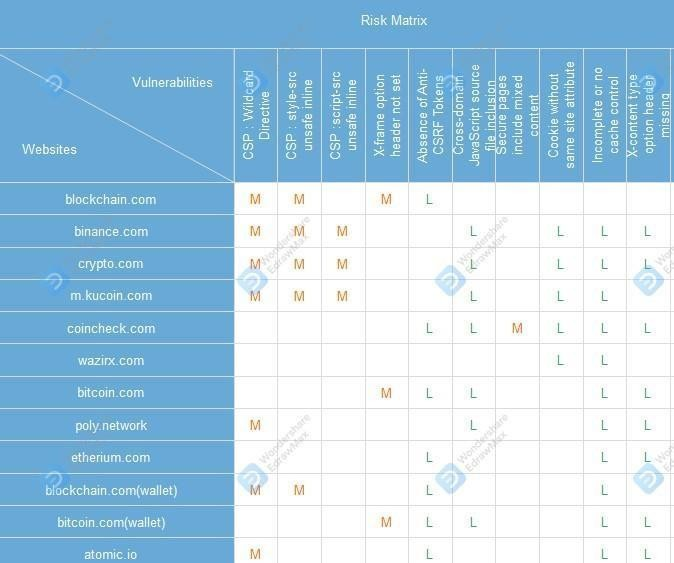
  <br><em>Figure 30: The empirical Risk Matrix as published in the B.Tech thesis.</em>
</p>

### 8.2 Vulnerability vs. Attack Matrix (Figure 31)

This matrix maps each evaluated vulnerability class to the concrete cyber attack vectors it facilitates:

| Attack Vector | CSP Wildcard | CSP style-src inline | CSP script-src inline | Missing X-Frame-Options | Missing Anti-CSRF | Cross-Domain JS | Mixed Content | Missing SameSite | Incomplete Cache-Control | Missing X-Content-Type |
| :--- | :---: | :---: | :---: | :---: | :---: | :---: | :---: | :---: | :---: | :---: |
| **XSS Attack** | **X** | **X** | **X** | - | - | - | - | - | - | **X** |
| **XSSI Attack** | - | - | - | - | - | **X** | - | **X** | - | - |
| **Data Injection Attack** | **X** | - | - | - | - | - | - | - | - | - |
| **Clickjacking Attack** | - | - | - | **X** | - | - | - | - | - | - |
| **CSRF Attack** | - | - | - | - | **X** | - | - | **X** | - | - |
| **Man-In-The-Middle Attack** | - | - | - | - | - | - | **X** | - | - | - |
| **Timing Attack** | - | - | - | - | - | - | - | **X** | - | - |
| **Cache Poisoning Attack** | - | - | - | - | - | - | - | - | **X** | - |
| **File Inclusion Attack** | - | - | - | - | - | **X** | - | - | - | - |
| **MIME Sniffing Attack** | - | - | - | - | - | - | - | - | - | **X** |

<p align="center">
  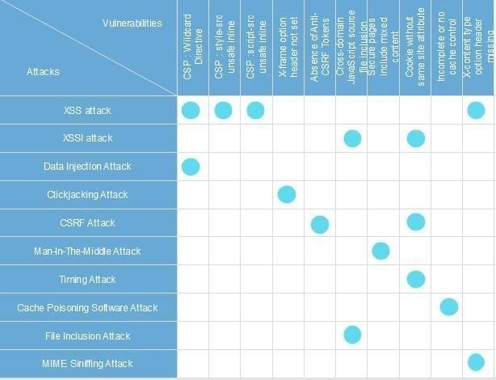
  <br><em>Figure 31: The Vulnerability vs Attack Matrix as published in the B.Tech thesis.</em>
</p>

---

## 9. Post-Breach Mitigation Case Studies

A unique contribution of the study was inspecting how cryptocurrency platforms adapted their defensive posture following major cyber incidents:

### KuCoin (`m.kucoin.com`)
- **Historical Context**: In September 2020, KuCoin suffered a $281 million hack targeting hot wallet private keys.
- **Architectural Findings**: HTTP response inspection revealed the server banner was deliberately obscured from default `nginx` to:
  ```http
  Server: IAS/1.4.2.3-1.17.3
  ```
  This indicates the deployment of an enterprise **Web Application Firewall (WAF)** and reverse-proxy load balancer concealing internal network topologies.

### Coincheck (`coincheck.com`)
- **Historical Context**: In January 2018, Coincheck lost $534 million in NEM tokens following an internal workstation compromise.
- **Architectural Findings**: The platform routed all traffic through **Amazon CloudFront** reverse proxies, deploying strict HSTS configurations and isolating wallet execution infrastructure from client-facing interfaces.

---

## 10. Framework Architecture & Codebase Design

The reconstructed codebase provides a clean, modular Python architecture that mirrors the academic methodology:

```
web-application-security-risk-analysis/
├── README.md                      # Comprehensive academic documentation
├── LICENSE                        # MIT License
├── pyproject.toml                 # Modern Python packaging configuration
├── requirements.txt               # Production dependencies
├── requirements-dev.txt           # Testing & linting specifications
├── Dockerfile                     # Containerized Kali Linux / Python environment
├── config/
│   └── targets.yaml               # Target definitions (URLs, IPs, WAFs, scopes)
├── docs/                          # In-depth architectural & methodology specifications
│   ├── ARCHITECTURE.md
│   ├── METHODOLOGY.md
│   ├── VULNERABILITY_CATALOG.md
│   ├── MITIGATION_CASE_STUDIES.md
│   └── REFERENCES.md
├── assets/                        # High-resolution screenshots extracted from thesis
│   ├── branding/
│   └── screenshots/
├── reports/
│   ├── raw/                       # Empirical console logs (Nmap, Nikto, WhatWeb, ZAP, SQLMap)
│   └── generated/                 # Exported matrices (CSV, JSON, Markdown)
├── vapt_framework/                # Core Python package
│   ├── cli.py                     # Rich command-line interface
│   ├── core/                      # Data models and scan coordinator
│   ├── modules/                   # Security auditing modules (HeaderAuditor, Nmap, ZAP, SQLMap)
│   ├── parsers/                   # Log parsers for scanner outputs
│   └── analytics/                 # RiskMatrixEngine and AttackMatrixEngine
├── scripts/                       # Kali Linux bash automation scripts
└── tests/                         # Comprehensive PyTest test suite (100% pass)
```

---

## 11. Installation & Reproduction Guide

### Local Environment Setup

1. **Clone the repository**:
   ```bash
   git clone https://github.com/your-username/web-application-security-risk-analysis.git
   cd web-application-security-risk-analysis
   ```

2. **Create a Python virtual environment**:
   ```bash
   python -m venv venv
   # On Linux/macOS:
   source venv/bin/activate
   # On Windows:
   .\venv\Scripts\activate
   ```

3. **Install dependencies**:
   ```bash
   pip install -r requirements.txt
   pip install -e .
   ```

### Running the Interactive CLI

- **View project metadata and attribution**:
  ```bash
  python vapt_framework/cli.py info
  ```

- **Audit a live target URL for the 10 vulnerability classes**:
  ```bash
  python vapt_framework/cli.py audit --url https://exchange.blockchain.com
  ```

- **Generate and inspect the Risk Matrix (Figure 30)**:
  ```bash
  python vapt_framework/cli.py matrix --type risk --format markdown
  ```

- **Generate the Vulnerability vs. Attack Matrix (Figure 31)**:
  ```bash
  python vapt_framework/cli.py matrix --type attack --format markdown
  ```

- **Export all empirical matrices to CSV, JSON, and Markdown**:
  ```bash
  python vapt_framework/cli.py export
  ```

### Docker Execution (Kali Linux)

To run in an isolated Kali Linux container with native penetration testing utilities:

```bash
docker build -t vapt-crypto-framework .
docker run --rm vapt-crypto-framework info
docker run --rm vapt-crypto-framework matrix --type both
```

---

## 12. Verification & Automated Tests

The framework includes a comprehensive test suite covering header auditing, parser logic, and matrix exports.

Run the test suite with `pytest`:
```bash
pytest tests/ -v
```

```
============================= test session starts =============================
platform win32 -- Python 3.14.6, pytest-9.2.0, pluggy-1.7.0
rootdir: C:\...\web-application-security-risk-analysis
collected 10 items

tests/test_attack_matrix.py::test_attack_matrix_mappings PASSED          [ 10%]
tests/test_attack_matrix.py::test_attack_matrix_exports PASSED           [ 20%]
tests/test_header_auditor.py::test_vulnerable_headers_and_html PASSED    [ 30%]
tests/test_header_auditor.py::test_secure_headers_clean PASSED           [ 40%]
tests/test_parsers.py::test_nmap_parser PASSED                           [ 50%]
tests/test_parsers.py::test_nikto_parser PASSED                          [ 60%]
tests/test_parsers.py::test_whatweb_parser PASSED                        [ 70%]
tests/test_parsers.py::test_zap_parser PASSED                            [ 80%]
tests/test_risk_matrix.py::test_risk_matrix_structure PASSED             [ 90%]
tests/test_risk_matrix.py::test_risk_matrix_formats PASSED               [100%]

============================= 10 passed in 0.14s ==============================
```

---

## 13. Conclusion & Future Work

Vulnerability Assessment and Penetration Testing is an essential cyber defense methodology for the cryptocurrency ecosystem. Even though decentralized protocols provide cryptographic consensus integrity, cryptocurrency interfaces remain susceptible to standard web vulnerabilities that can lead to severe client-side exploitation.

**Key Conclusions**:
1. None of the 10 evaluated targets exhibited critical, unmitigated server-side injection flaws (such as SQL injection) due to the widespread adoption of reverse-proxy WAFs (Cloudflare and AWS CloudFront).
2. However, medium- and low-risk client-side misconfigurations (notably CSP wildcard directives, inline script/style allowances, and missing clickjacking protections) remain widespread.
3. Only `m.kucoin.com` retained a legacy Web 2.0 architecture; the remaining 9 targets operate on Web 3.0 distributed paradigms.

**Future Scope**:
With explicit legal authorization, future work aims to expand automated testing to WebSocket endpoints, decentralized RPC gateway fuzzing, and smart contract front-running vectors across cross-chain bridge protocols.

---

## 14. References

1. Prof. Xilong Qu, *"International Journal of Computer & Communication Technology"*, ISSN: 0975-7449, Vol. 3, 2012, pp. 78-81.
2. Canadian Institute of Chartered Accountants (CICA), *"Using an Ethical Hacking Technique to Assess Information Security Risk"*, Toronto, Canada, 2003.
3. K. Scarfone, M. Souppaya, A. Cody, and A. Orebaugh, *"Technical Guide to Information Security Testing and Assessment"*, NIST SP 800-115, 2008.
4. N. Y. Hamisi and B. M. M. Mwinyiwiwa, *"Intrusion Detection by Penetration Test in an Organization Network"*, ICAST 2009, pp. 32-37.
5. Edith Cowan University, *"Penetration Testing and Vulnerability Assessment"*, International Cyber Resilience Conference, 2010.
6. G. McGraw, *"Software Security: Building Security In"*, Addison Wesley Professional, SANS GIAC, 2006.
7. J. Lenz, *"Technology Assurance Task Security and Privacy"*, Pace University RMA, 2003.
8. OWASP Foundation, *"OWASP Web Security Testing Guide (WSTG) - Release 4.2"*, 2020.
