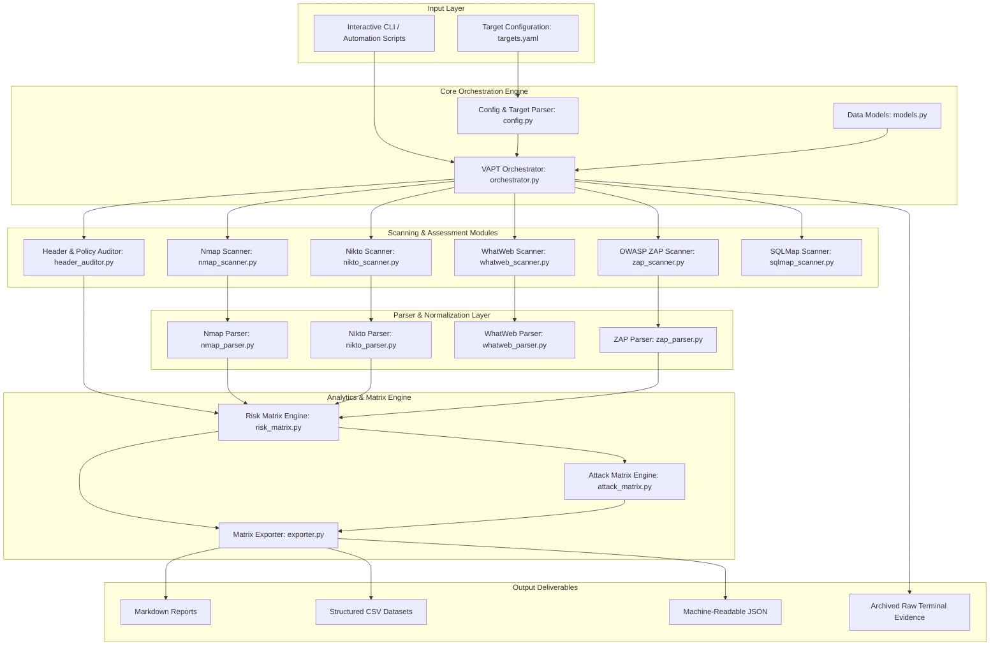

# System Architecture Specification

## Overview

The **Vulnerability Assessment and Penetration Testing (VAPT) Framework** was developed as part of the B.Tech Major Project at **Maharaja Surajmal Institute of Technology (MSIT)**, affiliated with **Guru Gobind Singh Indraprastha University (GGSIPU)**. The primary objective is to evaluate, audit, and mathematically quantify the security posture of modern cryptocurrency exchanges and Web3 non-custodial wallet portals.

## Architectural Components

### 1. Configuration & Target Modeling (`vapt_framework.core`)
- **`Target` Data Model**: Models web application endpoints, categorizing platforms by functional role (`exchange` vs. `wallet`), architecture (`Web 2.0` vs. `Web 3.0`), IP addresses, CDN/WAF infrastructures (Cloudflare, AWS CloudFront, Tengine), and scope boundaries.
- **`VulnerabilityFinding`**: Typed data container standardizing findings across disparate assessment tools using standardized identifiers (**CWE**, **WASC**, and **CVSSv3** severity ratings).

### 2. Multi-Tool Scanning Layer (`vapt_framework.modules`)
- **`HeaderAuditor`**: High-performance, zero-external-dependency auditor directly interrogating HTTP response headers, cookie flags, and DOM trees for client-side security policies.
- **Tool Wrappers**: Secure, non-blocking subprocess adapters orchestrating Kali Linux utilities:
  - `NmapScanner`: Port scanning and NSE vulnerability detection (`http-csrf`, `http-dombased-xss`, `http-stored-xss`, `ssl-ccs-injection`, `sslv2-drown`).
  - `NiktoScanner`: Web server security configuration scanning and banner identification.
  - `WhatWebScanner`: Technology fingerprinting (identifying reverse proxies, CMSs, and JS frameworks).
  - `ZAPScanner`: Headless driving of OWASP Zed Attack Proxy (passive/active scan rules and spidering).
  - `SQLMapScanner`: Automated SQL injection heuristic probing and WAF bypass verification.

### 3. Log Normalization & Parsing (`vapt_framework.parsers`)
Decouples raw, tool-specific console outputs from the analytical core. The parser layer ingests tool logs and translates them into structured Python objects for severity evaluation.

### 4. Analytics & Matrix Generation (`vapt_framework.analytics`)
- **`RiskMatrixEngine`**: Aggregates vulnerability observations across the 12 target systems and tabulates severity levels (**Medium**, **Low**, or **Not Found**), matching **Figure 30** of the thesis.
- **`AttackMatrixEngine`**: Maps identified security misconfigurations to active attack vectors (XSS, XSSI, Clickjacking, CSRF, MITM, Timing Attacks, Cache Poisoning, MIME Sniffing), matching **Figure 31** of the thesis.
- **`MatrixExporter`**: Serializes analytical results into multi-format representations (`.csv`, `.json`, `.md`).
