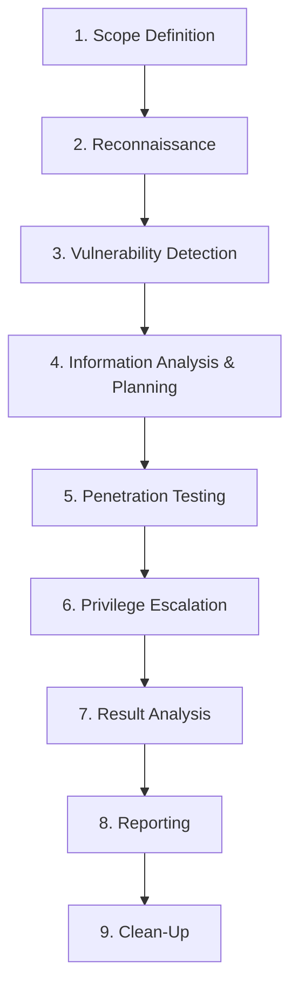

# VAPT Methodology & The 9-Stage Object Cycle

The research follows a formalized 9-stage Vulnerability Assessment and Penetration Testing (VAPT) methodology adapted specifically for distributed web applications and cryptocurrency platforms.

## Stage Breakdown

### 1. Scope Definition
- Defining testing boundaries: Public web application endpoints and REST APIs for exchanges and wallets.
- Model of assessment: Black-box testing (zero prior knowledge of internal source code or architecture) simulating an external, unauthenticated adversary.

### 2. Reconnaissance (Information Gathering)
- Network-level mapping: Resolving target IP addresses, detecting reverse proxies, load balancers, and CDN edges (Cloudflare, AWS CloudFront, Tengine).
- Service identification: Scanning ports (80, 443, 8080, 8443) using `nmap -sV -Pn`.
- Application fingerprinting: Enumerating technology stacks, server headers, and third-party libraries using `whatweb`.

### 3. Vulnerability Detection
- Automated scanning: Ingesting target endpoints into `OWASP ZAP 2.10.0`, `Nikto 2.1.6`, and `Uniscan 6.3`.
- Policy analysis: Auditing Content-Security-Policy (CSP) headers, clickjacking controls (`X-Frame-Options`), SameSite cookie attributes, and cache directives.
- Script scanning: Executing Nmap NSE scripts (`http-csrf`, `http-dombased-xss`, `http-stored-xss`, `sslv2-drown`).

### 4. Information Analysis & Planning
- Correlating findings across tools to eliminate false positives.
- Constructing the attack surface map for each platform.
- Planning non-destructive proof-of-concept injection attempts.

### 5. Penetration Testing & Exploitation Probing
- Injection testing: Probing URI parameters and input fields with `sqlmap` under conservative risk levels (`--level 1 --risk 1`) to analyze WAF response patterns.
- Authentication & state inspection: Evaluating forms for anti-CSRF challenge token presence.
- Mixed-content verification: Inspecting secure pages for active HTTP script inclusions.

### 6. Privilege Escalation
- Evaluating session management mechanics: Testing whether session tokens lacking `HttpOnly` or `SameSite` flags could allow horizontal or vertical account hijacking.

### 7. Result Analysis
- Classifying observed vulnerabilities into severity tiers (High, Medium, Low) based on CVSSv3 metrics, exploit likelihood, and business impact.
- Correlating vulnerabilities against threat actor capabilities.

### 8. Reporting
- Formulating the **Risk Matrix** (Figure 30) detailing vulnerability presence across all 12 evaluated cryptocurrency targets.
- Formulating the **Vulnerability vs. Attack Matrix** (Figure 31) illustrating active threat vectors.
- Providing defensive configuration remediations for production web servers.

### 9. Clean-Up
- Purging temporary scanner sessions and verifying target endpoint stability.
